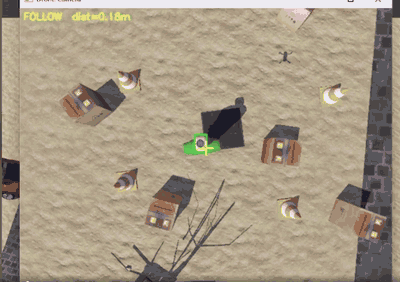
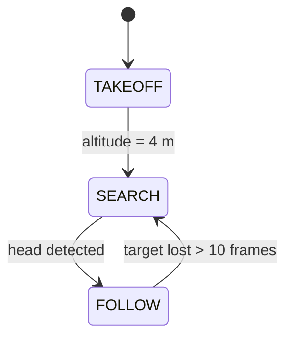

# Autonomous Umbrella Drone — Webots Simulation

> A simulated drone that **detects a pedestrian from above and stays right over their head** (to shield them from rain), using a YOLOv8n model fine-tuned on top-view images, a geometric pixel-to-metre conversion and a PI controller.



Semester project at **ENISo, National Engineering School of Sousse** (2025–2026), supervised by Mr. Hassen Mekki.

▶ [Full demo video](docs/demo.mp4) · 📄 [Report (FR)](docs/report-FR.pdf) · 📊 [Slides (FR)](docs/slides-FR.pdf)

---

## The challenge

Keeping a drone above a walking person means solving three linked problems in real time:

| Problem | Why it's hard | Our answer |
|---|---|---|
| **Perception:** where is the person? | Public datasets show people from the front; from 4 m above, only the top of the head is visible | **YOLOv8n fine-tuned** on a custom top-view dataset, annotated on the **head only** |
| **Estimation:** where is the head in metres? | The detector gives pixels; the motors need m/s | **Pinhole camera model** using altitude and field of view |
| **Control:** how to follow smoothly? | Detection boxes jump a few pixels between frames | **PI controller** (no derivative term, which amplified detection noise) |

All of it runs on a **CPU only**, with no GPU.

## How it works


### State machine



- **TAKEOFF:** climbs to 4 m using GPS, then hovers.
- **SEARCH:** runs YOLO on the camera feed and holds position until a head is detected.
- **FOLLOW:** converts the detection into a distance in metres and feeds it to the PI controller.
- **Dead reckoning:** if the person is lost briefly (occlusion, edge of the image), the drone keeps its last command for up to 10 frames before going back to SEARCH, so it doesn't jerk to a stop.

### Pixels → metres

For a camera pointing straight down at altitude *h*, with a normalised offset δ from the image centre:

```latex
d_x = \delta_x \cdot h \cdot \tan\left(\frac{FOV_x}{2}\right) \qquad d_y = \delta_y \cdot h \cdot \tan\left(\frac{FOV_y}{2}\right)
```

At 4 m with a 1.0 rad field of view, one pixel ≈ 6.6 mm on the ground. Below 0.35 m from the target, the drone switches from following to stabilising.

## Results (in simulation)

| Metric | Value |
|---|---|
| Final positioning error | ≈ 4 cm |
| Time to lock onto the target | ≈ 1.1 s |
| Max pedestrian speed tested | 0.875 m/s |
| YOLOv8n recall (head) | 0.984 |
| YOLOv8n mAP50 | 0.455 |
| Inference time (CPU) | ≈ 40 ms/frame |

**Detection model:** YOLOv8n, 50 epochs, batch 8, one class (pedestrian head), 597 manually annotated top-view images (LabelImg), including background images.

**What we tuned:** Kp was lowered from 1.5 to 0.75 to stop oscillations, and Ki was added to remove the residual error. YOLO runs on every second frame to keep the control loop fast. The dataset was re-labelled to cover the head only, so the drone centres exactly above the skull.

## Limitations

- Small dataset (597 images): the model sometimes fires on other objects, such as traffic cones, visible in the demo. The recall is high, but the precision (mAP50 0.455) leaves room for improvement.
- Simplified scene: no wind and no complex occlusions; the pedestrian walks in mostly straight lines.
- CPU only: about 40 ms per inference limits how fast the controller can react.

**Next steps:** a larger dataset, a Kalman filter to smooth the head position, model-predictive control to anticipate the pedestrian's movement, and tests on a real drone.

## Tech stack

Python · Webots R2023b (Mavic 2 Pro) · Ultralytics YOLOv8n · OpenCV · PyTorch (CPU) · NumPy · LabelImg

## About the code

This repository documents the project: method, results, demo, report and slides. The source code (the Webots drone controller, the trained `best.pt` weights and the dataset) is not included here.

## Team

Maryem Mlika, **El Aziza Mariem Lanouar** and Mohamed Mehdi Mrabet, supervised by Mr. Hassen Mekki (ENISo).
